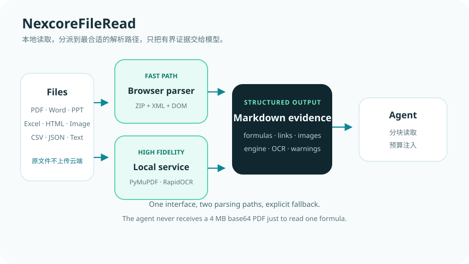

# NexcoreFileRead

### 把 PDF 丢给 Agent 时，丢掉的往往不只是版式。  
### 公式、图片、链接和扫描件正文，也可能一起消失。

[](https://github.com/yan-stone-computer/NexcoreFileRead/actions/workflows/test.yml)
[](LICENSE)
[](https://python.org/)
[](#privacy-and-boundaries)



NexcoreFileRead 是 [NexcoreWork](https://github.com/yan-stone-computer/nexcorework-site)
的本地文档读取层。它把 PDF、Office、图片、HTML 与数据文件变成 Agent 可消费的结构化 Markdown。

这个仓库由原 **TianShu2Markdown** 演进而来，保留原项目历史和 MIT 许可，同时把定位从
“一个文档转换网页”调整为“智能体可调用的文件读取基础设施”。

## 为什么再做一个文件读取器

因为“读到了字”不等于“读懂了文档”：

- PDF 公式被拆成表格碎片；
- Word / PPT 里的图片静默消失；
- PDF 链接只剩文字；
- 扫描件没有文本层，最后返回空内容；
- 原始文件被拿去云端转换；
- 转换结果没有标明用了 PDF、Office 还是 OCR 引擎。

NexcoreFileRead 的响应会明确告诉调用方：本次使用了哪个引擎、是否走过 OCR、是否发生降级，
以及有哪些警告。

## 组合方案

```text
Word / Excel / PowerPoint / HTML / CSV / JSON
  └─ 浏览器零依赖解析：ZIP + XML + DOMParser

PDF / 扫描件 / 公式 / 内嵌图片 / 复杂 Office
  └─ NexcoreFileRead 本地服务
       ├─ PyMuPDF：文本、链接、图片
       ├─ RapidOCR：扫描 PDF 与图片离线识别
       ├─ MarkItDown：Office / HTML / 数据格式分派
       └─ Office ZIP：内嵌图片提取

输出：有长度上限的结构化 Markdown
```

基础格式不依赖 Python 服务；高保真路径按需启动。服务不可用时，NexcoreWork 自动回退到浏览器
内置解析，不会让上传流程整体失败。

## 30 秒启动

```bash
git clone https://github.com/yan-stone-computer/NexcoreFileRead.git
cd NexcoreFileRead
python -m pip install -r requirements.txt
python launcher.py
```

默认只监听 `127.0.0.1:8765`。

```http
POST /api/convert
Content-Type: multipart/form-data

file=<document>
```

```json
{
  "filename": "paper.pdf",
  "markdown": "## 第 1 页\n\nln(Sit) = α0 + β1 ln(Pit)...",
  "ocr": false,
  "engine": "pymupdf",
  "warnings": []
}
```

## 可直接验证的结果

仓库包含可运行样例：

```bash
python -m unittest discover -s tests -v
```

回归测试覆盖：

- 公式 PDF 能产出分页 Markdown；
- Office 内嵌图片原样提取，不经重编码；
- 本地服务健康检查返回明确版本。

主项目组合调用已实测：NexcoreWork 通过 multipart 将 Word 文件转发给本服务，并拿回
`markitdown+office-images` 产出的结构化 Markdown。

## 支持的格式

| 格式 | 文本 | 图片 | 链接 | 扫描件 OCR |
|---|---:|---:|---:|---:|
| PDF | 是 | 是 | 是 | 是 |
| DOCX / PPTX / XLSX | 是 | 是 | 视格式 | 图片可单独识别 |
| 图片 | OCR 文本 | 原图内嵌 | 不适用 | 是 |
| HTML | 是 | 视输入 | 是 | 不适用 |
| CSV / JSON / TXT | 是 | 不适用 | 保留原文 | 不适用 |

## 安全与边界

- 只接受回环地址客户端；
- 单文件上限 100 MB；
- 不执行文档中的宏、脚本或嵌入对象；
- 不处理加密文档；
- 不保存请求长期状态；
- OCR 结果会标记为 OCR，不冒充原文；
- 纯图片公式只能识别，不能保证上下标完全正确。

如果你有转换后公式、图片或链接丢失的文档，欢迎脱敏后提交到 Issue 和样例集。

## 与 Nexcore 开放栈的关系

- [nexcore-context-governor](https://github.com/yan-stone-computer/nexcore-context-governor)
- [NexcoreMemory](https://github.com/yan-stone-computer/NexcoreMemory)
- [NexcoreVision](https://github.com/yan-stone-computer/NexcoreVision)
- [NexcoreToolGuard](https://github.com/yan-stone-computer/NexcoreToolGuard)
- [NexcoreAgent](https://github.com/yan-stone-computer/NexcoreAgent)

## 来源与许可

- 本仓库：MIT，见 [LICENSE](LICENSE)。
- 上游基础：Microsoft MarkItDown，MIT。
- PDF：PyMuPDF。
- OCR：RapidOCR + ONNX Runtime。
- Office 图片提取和 NexcoreWork 集成由 Nexcore 团队实现。

原 TianShu2Markdown 的 MarkItDown 二次开发归属说明继续适用。
